<div align="center">


# Bichitos

**Un terrario de bolsillo para iPhone.**<br>
Diseñas bichitos ridículos en pixel art, los sueltas en un mundo
y observas cómo se enamoran, se pelean, se persiguen y se escapan.

[](https://github.com/sanlega/bichitos/actions/workflows/ios-build-check.yml)
[](https://github.com/sanlega/bichitos/actions/workflows/ios-testflight.yml)


<br>

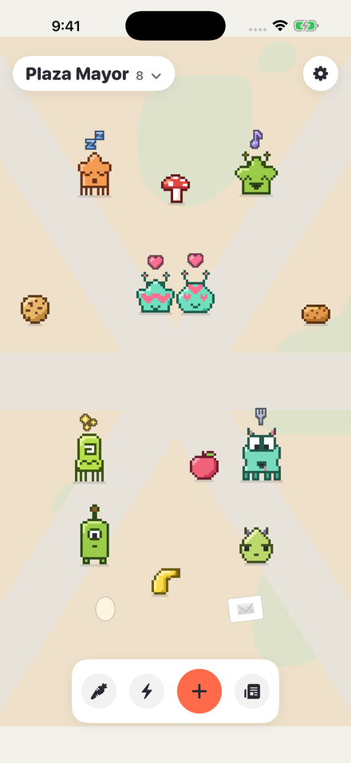&nbsp;
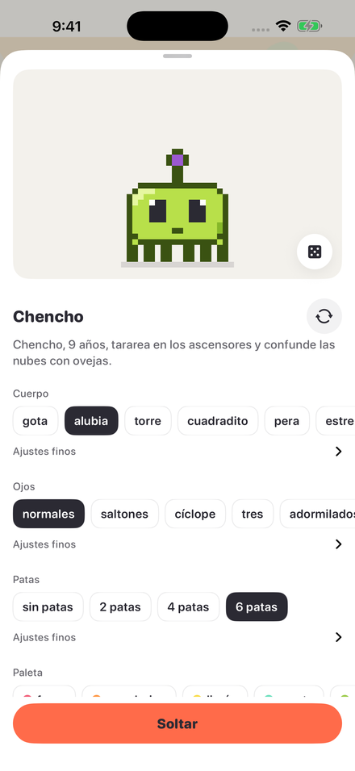&nbsp;
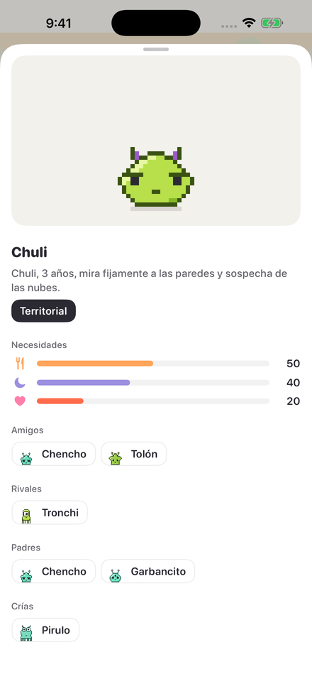

</div>

---

> *«Pocholo, 3 años, odia las esquinas y sospecha de las nubes.»*

Un Tamagotchi, pero con muchos bichitos que viven su vida aunque no mires. **Todo es procedural**:
el pixel art, el comportamiento y la voz. Sin samples, sin sprites dibujados a mano, sin dependencias
de terceros.

## Índice

- [Qué es](#qué-es)
- [El bichito: una receta](#el-bichito-una-receta)
- [El mundo](#el-mundo)
- [Diseño: "Terrario"](#diseño-terrario)
- [Cómo se juega](#cómo-se-juega)
- [Cómo está hecho](#cómo-está-hecho)
- [Desarrollo](#desarrollo)
- [Documentación](#documentación)

## Qué es

| | |
|---|---|
| 🎨 **Editor** | Elige cuerpo, ojos, patas, paleta y personalidad con chips. La vista previa respira, parpadea y reacciona en vivo. El dado tira otra variación. |
| 🌍 **Mundo vivo** | Un mapa continuo con 7 barrios, día y noche con el reloj real, casitas, nidos, bancos y comida. |
| 💞 **Relaciones** | Cada bichito recuerda a los demás. De peleas y mimos salen rivales y parejas que duran semanas, y de las parejas, huevos. |
| 🥺 **Escapadas** | Un bichito muy descuidado se va dejando una nota absurda. Solo vuelve si le dejas su comida favorita. Nadie muere. |
| ⏩ **Mientras no estás** | Al abrir la app, la simulación avanza acelerada hasta 7 días y te cuenta lo que pasó. |
| 🗣️ **Voz** | Balbuceo procedural tipo Animal Crossing, con tono y ritmo propios de cada bichito, en español e inglés. |

## El bichito: una receta

Cada bichito es una **receta**: unos pocos genes que el motor convierte en píxeles, comportamiento y voz.
Solo se guarda la receta; todo lo demás se regenera.

<p align="center">
  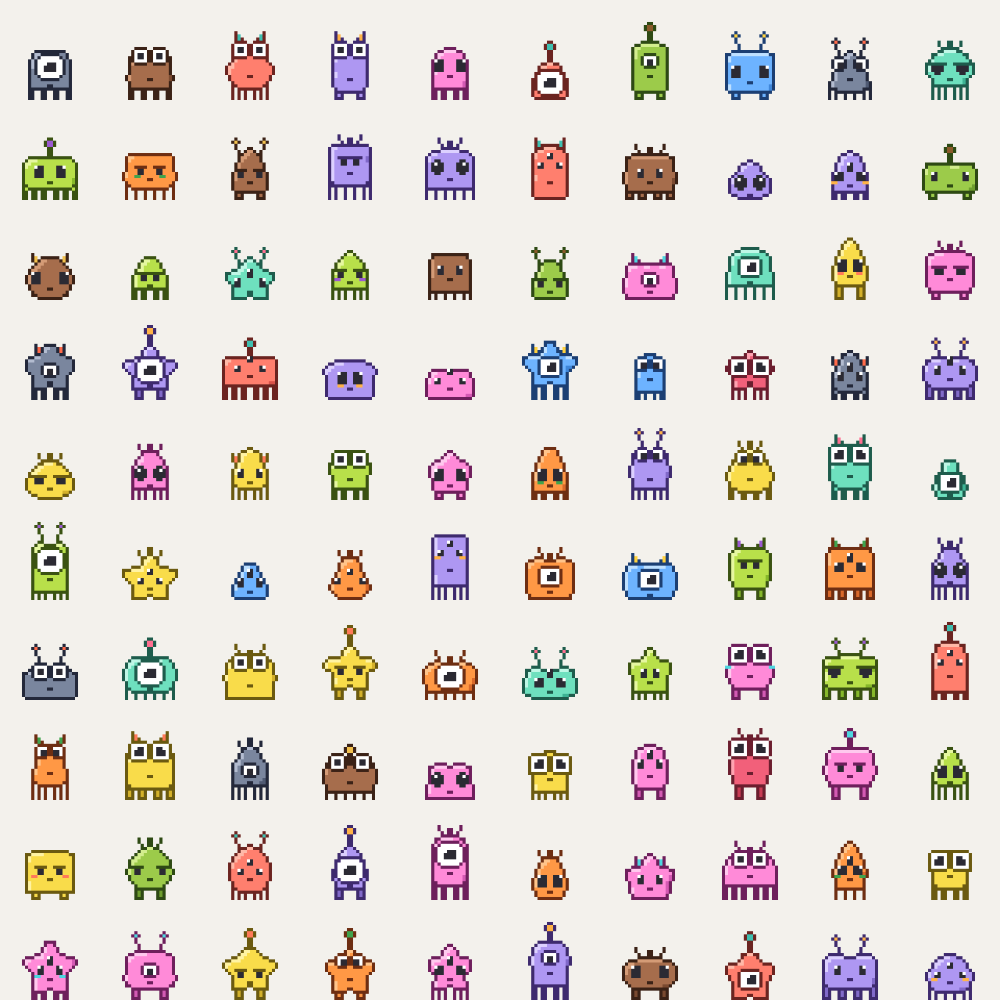
  <br><sub>100 semillas, 100 bichitos. Ninguno está dibujado a mano.</sub>
</p>

| Gen | Valores |
|---|---|
| Cuerpo | gota, alubia, torre, cuadradito, pera, estrella blanda |
| Ojos | normales, saltones, cíclope, tres, adormilados |
| Patas | 0, 2, 4 o 6, con largo ajustable |
| Paleta | fresa, mandarina, limón, menta, aguacate, cielo, lavanda, chicle, cacao, pizarra, coral, lima |
| Personalidad | curiosa, nerviosa, dormilona, hiperactiva, territorial, romántica |
| Semilla | `UInt64`: variaciones dentro de lo elegido |
| Versión del motor | Qué generador lo dibuja, para que una actualización nunca le cambie la cara a nadie |

La personalidad se ve a simple vista: la nerviosa lleva pelos de punta, la territorial cuernitos,
la hiperactiva antenas, la romántica mofletes, la curiosa una antena con bolita y la dormilona va
con el cuerpo caído.

<p align="center">
  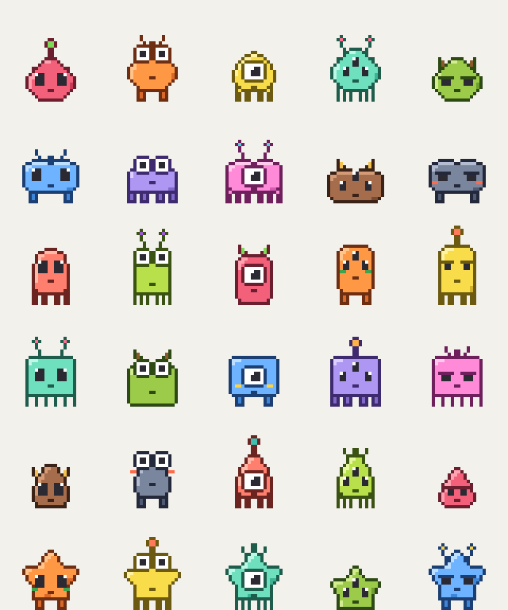
  <br><sub>Seis cuerpos × cinco ojos.</sub>
</p>

Las nueve **expresiones** salen de variar ojos y boca, no de dibujos: normal, parpadeo, dormido,
enamorado, enfadado, asustado, hambriento, contento y mareado.

<p align="center">
  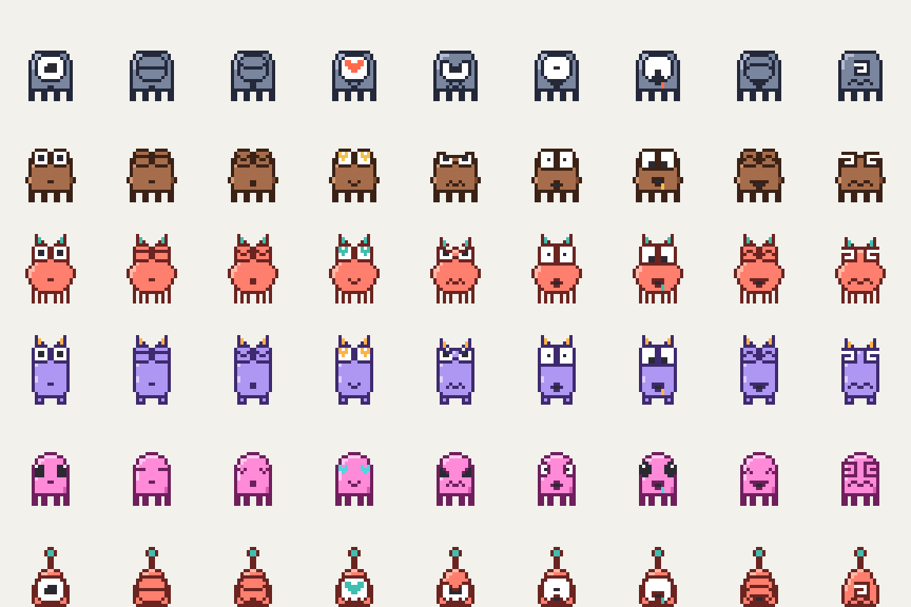
  <br><sub>De izquierda a derecha: normal, parpadeo, dormido, enamorado, enfadado, asustado, hambriento, contento, mareado.</sub>
</p>

Las necesidades también se ven: con hambre adelgaza y pierde color; bien cuidado, está rechoncho y brillante.

<p align="center">
  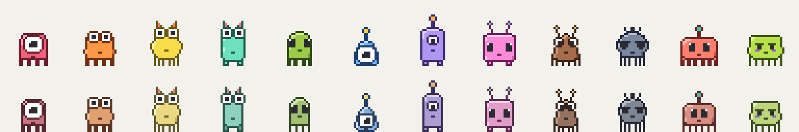
  <br><sub>Las 12 paletas. Abajo, los mismos bichitos descuidados.</sub>
</p>

## El mundo

El terrario es un cristal limpio y casi vacío; los bichitos son lo único pixelado, así que son los
protagonistas. Plaza Mayor está en el centro y, a medida que crece la población, se desbloquean los
barrios temáticos a su alrededor, empezando por el más afín a tus bichitos.

| Barrio | Afín a | Monumento |
|---|---|---|
| 🟠 Plaza Mayor | nadie | Fuente redonda |
| 🔵 Villa Charco | curiosa | Telescopio |
| 🟤 Las Esquinas | territorial | Torre con banderita |
| 🟣 Almohadilla | dormilona | Hamaca gigante |
| 🟡 Pista Loca | hiperactiva | Rueda de hámster |
| 🟢 El Matorral | nerviosa | Caja con agujero |
| 🌸 La Rosaleda | romántica | Glorieta con banco |

Caben 14 bichitos por barrio. Cada uno tiene su casita (de noche se le enciende la ventana), los
enamorados van al banco, los huevos se incuban en el nido y los bichitos **emigran** solos hacia el
barrio de su personalidad y hacia sus amigos.

Hay **5 comidas** en pixel art: fruta, galleta, seta, croqueta y macarrón. Cada bichito tiene una
favorita que heredan sus crías.

<p align="center">
  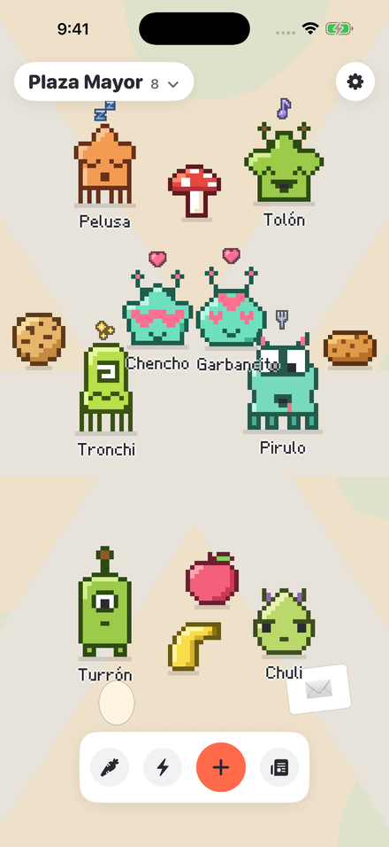&nbsp;
  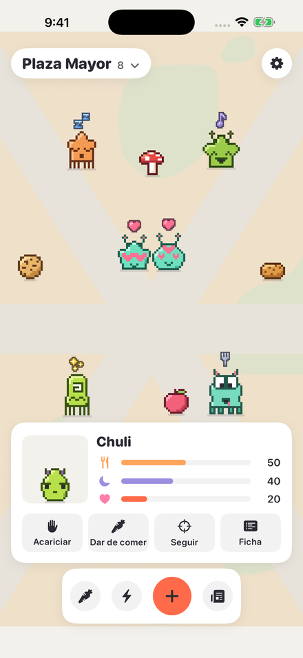&nbsp;
  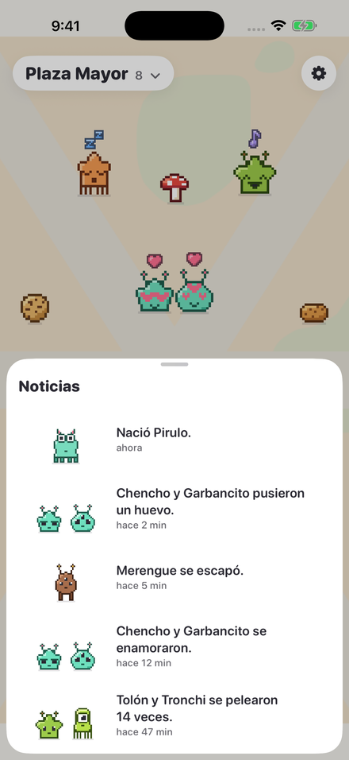
  <br><sub>Zoom de calle · tocar un bichito · las noticias del terrario</sub>
</p>

## Diseño: "Terrario"

Bichitos en pixel art, crujientes y llenos de color, viviendo en un mundo moderno, suave y casi
vacío. El contraste es intencionado: el mundo es un terrario de cristal limpio y los bichitos son lo
único pixelado.

1. **Los bichitos primero.** El mundo y la interfaz son tranquilos y de poco contraste; el color
   fuerte y el pixel art son solo de los bichitos.
2. **Píxeles honestos.** Un píxel del bichito es siempre un cuadrado entero en pantalla: nunca se
   suaviza, nunca se escala a tamaños no enteros, nunca se rota.
3. **Exagerar con píxeles.** El squash & stretch, los saltos y las expresiones generan píxeles
   nuevos, no deforman la textura.
4. **Se lee sin menús.** Lo que siente un bichito se ve en su cara, su forma y su burbuja.
5. **Zona del pulgar.** Las acciones viven en una bandeja inferior.

<p align="center">
  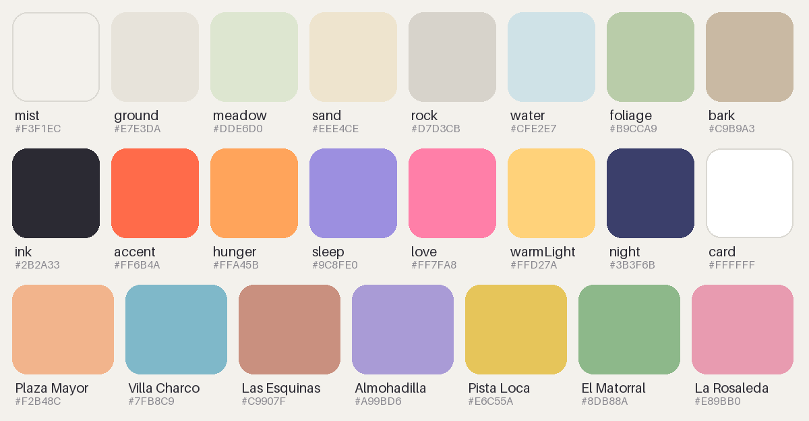
  <br><sub>Terreno · interfaz · tintes de los barrios</sub>
</p>

Regla rápida: si un bichito se lo come, lo pone o le sale de la cabeza, es pixel art. Si estaba ahí
antes que él, es suave.

## Cómo se juega

| Gesto | Qué pasa |
|---|---|
| Tocar | Acariciar, dar de comer, seguirlo con la cámara o abrir su ficha |
| Frotar encima | Se aplasta de gusto (o se queja si dormía) |
| Arrastrar y soltar | Lo lanzas: rebota y se marea |
| Modo comida + tocar el suelo | Cae comida; los hambrientos corren a por ella |
| Agitar el móvil | Susto general |
| Mantener pulsado | Ficha: personalidad, necesidades, parientes, amigos y rivales |
| Pellizcar | Zoom entre los niveles Mapa, Barrio, Calle y Cerca |

Todas las acciones existen también como botones y acciones de VoiceOver. La voz y la vibración se
apagan por separado en Ajustes.

## Cómo está hecho

SwiftUI + SpriteKit, iOS 17+, sin dependencias de terceros.

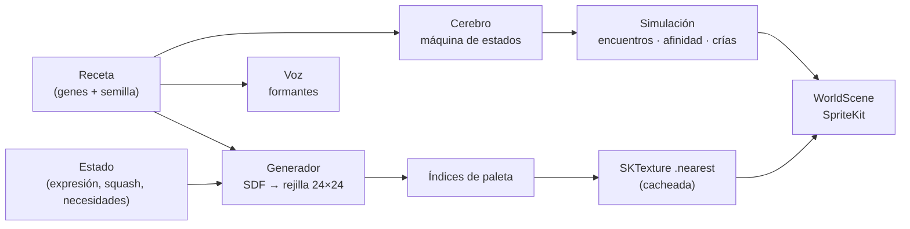

- **Motor de sprites**: `(receta, estado) → rejilla de índices → textura`, una función pura y
  determinista. La silueta sale de un campo de distancia (SDF) por tipo de cuerpo; el squash &
  stretch se aplica *antes* de rasterizar, así que el aplastado sigue siendo pixel art limpio.
  Contorno y sombreado son automáticos, con la luz arriba a la izquierda.
- **Simulación**: cada bichito es una máquina de estados (pasear, dormir, comer, enamorarse,
  pelear, perseguir, huir, imitar…). Los encuentros se deciden por personalidad y afinidad.
- **Sin pantalla**: el generador y la simulación son Swift puro (solo Foundation), así que corren
  en los tests y en el avance rápido de "mientras no estabas".
- **Versionado**: cada versión del generador se conserva en el código y cada bichito se dibuja
  siempre con la suya.

### Estructura

```
ios/
├── project.yml        # XcodeGen: el .xcodeproj no se versiona
├── Bichitos/
│   ├── Recipe, Generator, Pixels, Sprites, LiveSprite, Look     # receta → píxeles
│   ├── Brain, Sim, Pen, Relations, Breeding                     # simulación
│   ├── Barrios, Terreno, Suelo, Comida, Noticias                # mundo
│   ├── Names, Phrases, Babble, Speaker                          # nombres, frases y voz
│   ├── WorldScene, Camera, Gesture, Labels, PixelFont           # SpriteKit
│   └── WorldView, Editor, CreatorSheet, BichitoCard, Theme…     # SwiftUI
├── BichitosTests/     # generador, simulación, galería, gestos, voz…
└── fastlane/          # subida a TestFlight
```

## Desarrollo

```sh
brew install xcodegen
cd ios
xcodegen generate
open Bichitos.xcodeproj
```

**CI** (`ios-build-check`): en cada PR que toca `ios/`, un runner de macOS genera el proyecto,
compila, pasa los tests y sube como artefactos el log, una **galería en PNG** de bichitos generados
y capturas del mundo, el editor y la ficha.

**TestFlight** (`ios-testflight`): al empujar una etiqueta `v*` (por ejemplo `v0.2.0`) se compila,
firma y sube una build; la etiqueta es la versión que ven los testers. También se puede lanzar a mano.

## Documentación

- [docs/CONCEPT.md](docs/CONCEPT.md): el bichito, el motor de sprites, el mundo y el comportamiento
- [docs/DESIGN.md](docs/DESIGN.md): el sistema de diseño "Terrario": paletas, mapa, zoom e interfaz

<div align="center">
<sub>Hecho con píxeles honestos 🐛</sub>
</div>
